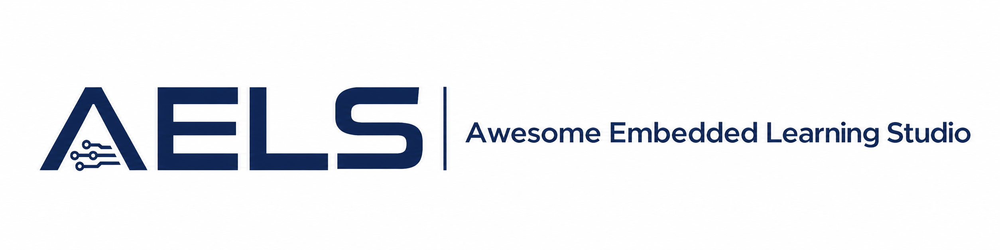

<picture>
  <source media="(prefers-color-scheme: dark)" srcset="AELS-Header-Logo-Dark.png" />
  
</picture>

**一个持续尝试现代 C++、横跨 MCU 与嵌入式 Linux 的嵌入式开源学习工作室**

*Keep it small, make it fun*

  
  &nbsp;
  
  &nbsp;
  

 

<table>
  <tr>
    <td align="center">
      <a href="https://github.com/orgs/Awesome-Embedded-Learning-Studio/discussions/7">
        
         
        <b>AELS 交流群</b> · 645248275
      </a>
    </td>
    <td align="center">
      <a href="https://github.com/Awesome-Embedded-Learning-Studio/Tutorial_AwesomeModernCPP">
        
         
        <b>TAMCPP 群</b> · 1107100989
      </a>
    </td>
  </tr>
</table>

---

> PS: LLM 部分参与了一些教程内容和代码中。众所周知难免有所疏忽。
> 
> 兄弟们都是用爱放电。发现问题，欢迎 Issue At 我们，会及时响应修复！

## 这里是什么 / OK so what's this bro

嘿！这里是笔者和一些朋友一起正在做的一些小玩具和小教程构成，正在持续建设和开发的组织！

简单的说：是一些系统软件，嵌入式 MCU 和 Linux 的项目和教程集合。我们期望用现代 C++ 的形式，重放嵌入式和系统编程领域的内容！*Keep it small, make it fun!*

我们希望这些项目，可以给您和您的Agent一些启发，带着您的Agent一起初步入门嵌入式和系统软件开发。让您在嵌入式开发（目前不包含硬件。。。但是我们会努力！）和计算机底层开发中开心的遨游！

## 从这里开始 / Bootstrap from here

其实，每个人的基础都不一样！但是如果您是新手，我们认为您可以从这里开始:[我该从哪里开始 / Where should I Start?!](https://awesome-embedded-learning-studio.github.io/Awesome-Embedded/guide/)。

简单的说，如果您甚至只能让您的 Agent 替代您做任何 Linux 上的操作而完全看不懂他在做什么。这些项目是我们正在忙于开发的！

[EmbedBox（仍然在开发ing）](https://github.com/Awesome-Embedded-Learning-Studio/EmbedBox) 从终端、Git、编译和调试这些基本操作开始！上路先回开车！

如果您对语言基础比较困惑。截至到目前，C和C++仍然是嵌入式开发的首选。您可以到这里来~

- [ModernCPP](https://github.com/Awesome-Embedded-Learning-Studio/Tutorial_AwesomeModernCPP)：我们正在维护的一套偏向嵌入式开发的大集合C++仓库
- [C-Journey（谨慎学习，正在重构ing）](https://github.com/Awesome-Embedded-Learning-Studio/C-Journey): 我们正在维护的C教程

如果上述都不构成你学习的难题，并且第一次学习板级 Linux。可以从：

[imx-forge（仍然正在优化ing!）](https://github.com/Awesome-Embedded-Learning-Studio/imx-forge) 开始；

已有 BSP 经验、目标是 Rockchip 平台，可以直接进入：

[rk-forge](https://github.com/Awesome-Embedded-Learning-Studio/rk-forge)。

> 单片机有st-forge，但是笔者精力有限，更新较慢哦~

## 看看项目

哈？都不喜欢？对操作系统感兴趣？正巧来看看由 C++23 编写、探索 Linux 用户态兼容的 [Cinux](https://github.com/Awesome-Embedded-Learning-Studio/Cinux)！从启动代码一路写到进程、文件系统和图形桌面，最后还能在自己的系统里重新编译内核。想知道这一路是怎么走过来的？[Cinux-Book](https://github.com/Awesome-Embedded-Learning-Studio/Cinux-Book) 里有笔者的一些教程记录，带着您的 QEMU 一起来玩！

[Visor](https://github.com/Awesome-Embedded-Learning-Studio/visor) 是一套可以独立使用的跨平台 GUI 框架，[Vesper](https://github.com/Awesome-Embedded-Learning-Studio/vesper) 则用它搭起 Cinux 的桌面。想折腾窗口、控件和桌面交互？也欢迎来这两边逛逛~

比起内核，您更喜欢看得见、点得动的界面？那来看看 [Qt 教程](https://github.com/Awesome-Embedded-Learning-Studio/Tutorial_AwesomeQt)！从第一个窗口开始，慢慢弄明白信号槽、控件和事件是怎么配合的。想看看我们拿 Qt 在做什么？[CFDesktop](https://github.com/Awesome-Embedded-Learning-Studio/CFDesktop) 正在搭自己的嵌入式桌面，[QuarkWidgets](https://github.com/Awesome-Embedded-Learning-Studio/QuarkWidgets) 则收着其中用到的 Material Design 3 控件，一起慢慢打磨中~

窗口也先放一边，终端才是您的快乐老家？[CFBox](https://github.com/Awesome-Embedded-Learning-Studio/CFBox) 在用 C++23 重新实现一组 Unix 小工具。平时随手敲下的命令，自己写起来会遇到什么问题？我们就从这些问题开始折腾，还把它放到了 i.MX6ULL 上当 PID 1 跑！

觉得这些工程还是太大，想先完整做完一个小东西？[engineering_cpp](https://github.com/Awesome-Embedded-Learning-Studio/engineering_cpp) 从小工具和小库开始，陪您把需求、代码、测试和构建一步步串起来。

完整的项目介绍和当前进展放在[仓库目录](https://awesome-embedded-learning-studio.github.io/Awesome-Embedded/projects/)。想知道这些内容如何衔接，可以再看[学习关系](https://awesome-embedded-learning-studio.github.io/Awesome-Embedded/roadmap/)，按自己的基础选择和回补。

## 一起玩

- 有问题、想法、路线建议：来 [Discussions](https://github.com/orgs/Awesome-Embedded-Learning-Studio/discussions) 开一贴，或者进 QQ 群。
- 想动手改点什么：先读[贡献指南](https://awesome-embedded-learning-studio.github.io/Awesome-Embedded/contributing/)，仓库里标了 good first issue 的都可以直接认领。
- 想知道接下来做什么：看 [Roadmap](https://awesome-embedded-learning-studio.github.io/Awesome-Embedded/roadmap/)。

## 读到这里了！

如果里面的项目对您有所帮助，欢迎⭐⭐我们， 随意 Fork 爆改。玩的开心~

## 维护者

<table>
  <tr>
    <td align="center">
      <a href="https://github.com/HNHKHNH">
         
        <strong>HNHKHNH</strong>
      </a>
       
      硬件 / PCB
    </td>
    <td align="center">
      <a href="https://github.com/Charliechen114514">
         
        <strong>Charliechen114514</strong>
      </a>
       
      C / C++ / 系统软件
    </td>
    <td align="center">
      <a href="https://github.com/Leon19960120">
         
        <strong>Leon19960120</strong>
      </a>
       
      文档审校 / 工程勘误
    </td>
    <td align="center">
      <a href="https://github.com/owollz4">
         
        <strong>owollz4</strong>
      </a>
       
      习题与参考答案
    </td>
    <td align="center">
      <a href="https://github.com/xiaoshuaijie">
         
        <strong>xiaoshuaijie</strong>
      </a>
       
      参考答案 / 构建与调试
    </td>
  </tr>
</table>

---

  Released under the <a href="https://opensource.org/licenses/MIT">MIT License</a>.
   
  

